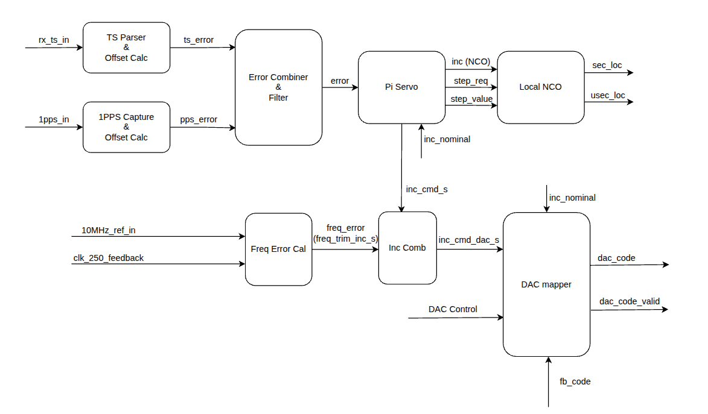

# Time Sync System

> Last updated: 2026-05-22 (English translation)

## 1. System Objective
The `time_sync` system generates and maintains local time (`sec_loc`, `usec_loc`) inside the FPGA and synchronizes it using two reference sources:
- `rx timestamp` (Aurora): provides an absolute time reference.
- `1PPS`: provides an accurate second boundary.

System block diagram:


Overall flow:
1. Measure time error from each source.
2. Combine/filter the error.
3. PI servo computes `inc` (NCO frequency control) and decides whether to trigger a `hard step` for large errors.
4. NCO updates local time.
5. FSM selects runtime mode: `FREE_RUN` / `PPS_ONLY` / `TS_ONLY` / `FULL_SYNC` / `HOLDOVER`.

---

## 2. Module Roles
- `time_sync_top.vhd`: top module; contains mode/state FSM, timeout logic, holdover logic, and interconnects the full datapath.
- `ts_offset_calc.vhd`: computes timestamp offset `offset_us = time_local - time_rx` (3-stage pipeline).
- `pps_cap.vhd`: synchronizes PPS rising edge, captures local time at PPS edge, computes `pps_error_us`.
- `error_combiner_filter.vhd`: combines TS/PPS error by mode and applies IIR filtering.
- `time_servo_pi.vhd`: PI controller that generates `inc` and issues `step` command when error exceeds threshold.
- `local_time_nco.vhd`: local time generator using phase-accumulator NCO plus step correction.
- `vcxo_dac_mapper.vhd`: maps `inc_cmd` to DAC code with scale, clamp, slew-limit, and saturation flags for anti-windup.
- `vcxo_freq_error.vhd`: measures frequency error between VCXO feedback `clk` and `vcxo_ref_10m`, producing `freq_err_cycles` samples for trim loop.

---

## 3. Top-Level I/O (`time_sync_top`)

### Inputs
- `clk`, `rst`.
- `cfg_mode[2:0]`:
  - `000`: AUTO
  - `001`: FORCE_FREE_RUN
  - `010`: FORCE_PPS_ONLY
  - `011`: FORCE_TS_ONLY
  - `100`: FORCE_FULL_SYNC
  - `101`: FORCE_HOLDOVER
- `pps_in`: asynchronous PPS pulse.
- `rx_ts_valid`, `rx_sec`, `rx_usec`: timestamp from Aurora.
- `inc_nominal`: nominal NCO increment.
- `vcxo_ctrl_en`: enable VCXO control path through AD5680 DAC.
- `vcxo_ref_10m`: 10MHz reference clock used by the VCXO frequency-lock feedback branch.
- `dac_fb_code`, `dac_fb_valid`: DAC readback code and valid pulse from external DAC interface.

### Outputs
- Local time: `sec_loc`, `usec_loc`.
- System state/status: `run_state_out`, `pps_ok_out`, `ts_ok_out`, `sync_locked_out`, `holdover_out`.
- Debug: `offset_us_out`, `pps_error_us_out`, `error_us_out`, `inc_out`, `tick_us`.
- DAC/VCXO: `dac_code_out`, `dac_update_pulse`.

---

## 4. Detailed Module Description

## 4.1 `ts_offset_calc`
### Role in the system
Computes time offset from received timestamp:

`offset_us = (sec_loc - rx_sec) * 1_000_000 + (usec_loc - rx_usec)`

- `offset_us > 0`: local clock is ahead.
- `offset_us < 0`: local clock is behind.

### Input ports
| Port | Type | Function |
|---|---|---|
| `clk` | input | Clock for the internal 3-stage pipeline. |
| `rst` | input | Synchronous reset for internal registers and `offset_valid`. |
| `sec_loc` | input | Local-time seconds used for comparison with `rx_sec`. |
| `usec_loc` | input | Local-time microseconds used for comparison with `rx_usec`. |
| `rx_ts_valid` | input | Valid strobe for incoming timestamp; when `1`, the module samples local/rx values. |
| `rx_sec` | input | Received timestamp seconds from Aurora. |
| `rx_usec` | input | Received timestamp microseconds from Aurora. |

### Output ports
| Port | Type | Function |
|---|---|---|
| `offset_valid` | output | 1-clock pulse indicating `offset_us` is updated and valid. |
| `offset_us` | output | Signed error in microseconds, forwarded to the combiner/filter block. |

### Latency
- Nominal latency `rx_ts_valid -> offset_valid`: about 2 clocks.

---

## 4.2 `pps_cap`
### Role in the system
Synchronizes asynchronous PPS into the local clock domain, captures local time at PPS edge, and computes PPS error around the second boundary.

### Input ports
| Port | Type | Function |
|---|---|---|
| `clk` | input | Clock for PPS synchronization and capture logic. |
| `rst` | input | Reset for synchronizer and output registers. |
| `pps_in` | input | External asynchronous 1PPS pulse. |
| `sec_loc` | input | Local seconds at PPS capture moment. |
| `usec_loc` | input | Local microseconds at PPS capture moment. |

### Output ports
| Port | Type | Function |
|---|---|---|
| `pps_valid` | output | 1-clock pulse when synchronized PPS rising edge is detected. |
| `sec_at_pps` | output | Captured `sec_loc` at PPS edge (monitor/debug). |
| `usec_at_pps` | output | Captured `usec_loc` at PPS edge (monitor/debug). |
| `pps_error_us` | output | Signed PPS error around second boundary, used by servo via combiner. |

### Algorithm note
- `pps_error_us` is mapped near `[-500000 .. +499999]` us to represent deviation from the nearest second boundary.

---

## 4.3 `error_combiner_filter`
### Role in the system
Receives TS/PPS errors, selects or fuses them by mode, then applies IIR filtering to produce a smooth error signal for the PI servo.

### Input ports
| Port | Type | Function |
|---|---|---|
| `clk` | input | Clock for internal 3-stage pipeline (latch/select, combine, filter). |
| `rst` | input | Resets all combiner/filter states. |
| `use_offset` | input | Enables TS path (`offset_us`). |
| `use_pps` | input | Enables PPS path (`pps_error_us`). |
| `hold_filter` | input | Holds current filtered value; no new valid output is emitted. |
| `clear_filter` | input | Clears filter/latch states to a clean condition. |
| `offset_valid` | input | Valid pulse for new `offset_us` from `ts_offset_calc`. |
| `offset_us` | input | Signed TS error (us). |
| `pps_valid` | input | Valid pulse for new `pps_error_us` from `pps_cap`. |
| `pps_error_us` | input | Signed PPS error (us). |

### Output ports
| Port | Type | Function |
|---|---|---|
| `error_valid` | output | 1-clock pulse indicating new combined/filtered `error_us`. |
| `error_us` | output | Combined and filtered error forwarded to `time_servo_pi`. |

### Algorithm
- TS-only: `comb = TS`.
- PPS-only: `comb = PPS`.
- FULL_SYNC: `comb = TS - (TS - PPS)/2^COMB_SHIFT`.
- IIR filter: `y(k+1) = y(k) + (comb - y(k))/2^FILT_SHIFT`.

---

## 4.4 `time_servo_pi`
### Role in the system
Adjusts NCO rate via PI control using `inc`, and issues a `hard step` when the error magnitude exceeds threshold.

### Input ports
| Port | Type | Function |
|---|---|---|
| `clk` | input | Clock for internal 2-stage PI pipeline. |
| `rst` | input | Resets PI state (`p_term`, `i_term`) and control outputs. |
| `servo_enable` | input | Enables sampling of error and PI update. |
| `hold_servo` | input | Freezes PI state; no update to `inc`. |
| `clear_servo` | input | Clears PI state and restores `inc` to `inc_nominal`. |
| `allow_step` | input | Allows `step_req` when error exceeds `STEP_THRESH`. |
| `error_valid` | input | Valid pulse for `error_us` from combiner/filter. |
| `error_us` | input | Signed error (us) used for PI math or step detection. |
| `inc_nominal` | input | Nominal increment used as PI baseline. |

### Output ports
| Port | Type | Function |
|---|---|---|
| `inc` | output | NCO increment command in sync modes. |
| `step_req` | output | Pulse requesting hard step correction of local time. |
| `step_offset_us` | output | Step magnitude (us) associated with `step_req`. |

### Algorithm
- If `|error_us| > STEP_THRESH` and `allow_step=1`: trigger step and reset PI state.
- Otherwise: `inc = inc_nominal + p + i`, with `p = -error/2^KP_SHIFT`, and `i` integrated via `KI_SHIFT`.

---

## 4.5 `local_time_nco`
### Role in the system
Generates local time from NCO phase accumulator and applies step commands to quickly pull local time toward reference.

### Input ports
| Port | Type | Function |
|---|---|---|
| `clk` | input | Clock for accumulator and local time counters. |
| `rst` | input | Resets `phase_acc`, `sec_loc`, `usec_loc`, `tick_us`. |
| `inc` | input | NCO increment controlling microsecond tick rate. |
| `step_req` | input | Requests hard step in current cycle. |
| `step_offset_us` | input | Error magnitude used to compute stepped local time. |

### Output ports
| Port | Type | Function |
|---|---|---|
| `sec_loc` | output | Local-time seconds; also fed back to error-measurement modules. |
| `usec_loc` | output | Local-time microseconds. |
| `tick_us` | output | Internal 1us pulse (phase-accumulator carry), for debug/monitoring. |

### Algorithm
- Natural flow: `phase_acc += inc`; carry generates `tick_us`; then update `usec_loc/sec_loc`.
- Step flow: apply `local_new = local_old - error` with step magnitude saturation.

---

## 4.6 `time_sync_top`
### Role in the system
Top-level orchestrator: manages mode/state, monitors source availability, controls combiner + servo + NCO selection, and exports monitor/status signals.

### Input ports
| Port | Type | Function |
|---|---|---|
| `clk` | input | Global clock for entire time-sync subsystem. |
| `rst` | input | Global reset to initialized runtime state. |
| `cfg_mode` | input | Runtime mode select (`AUTO`, `FORCE_*`) for FSM behavior. |
| `pps_in` | input | External PPS source routed to `pps_cap`. |
| `rx_ts_valid` | input | Valid strobe for Aurora timestamp routed to `ts_offset_calc`. |
| `rx_sec` | input | Received timestamp seconds. |
| `rx_usec` | input | Received timestamp microseconds. |
| `inc_nominal` | input | Nominal NCO increment used in free-run and as PI baseline/init value. |
| `vcxo_ctrl_en` | input | Enables/disables VCXO control path via AD5680. |
| `vcxo_ref_10m` | input | 10MHz reference clock input to `vcxo_freq_error` for VCXO frequency feedback. |
| `dac_fb_code` | input | DAC readback code from the external DAC wrapper. |
| `dac_fb_valid` | input | 1-cycle pulse indicating `dac_fb_code` is valid. |

### Output ports
| Port | Type | Function |
|---|---|---|
| `sec_loc` | output | Final local seconds output of the subsystem. |
| `usec_loc` | output | Final local microseconds output of the subsystem. |
| `run_state_out` | output | Current runtime FSM state (`FREE_RUN`, `PPS_ONLY`, `TS_ONLY`, `FULL_SYNC`, `HOLDOVER`). |
| `pps_ok_out` | output | PPS source alive flag from timeout monitoring. |
| `ts_ok_out` | output | Timestamp source alive flag from timeout monitoring. |
| `sync_locked_out` | output | Indicates current sync-active states (`PPS_ONLY/TS_ONLY/FULL_SYNC`). |
| `holdover_out` | output | Indicates system is in HOLDOVER state. |
| `offset_us_out` | output | Raw TS error from `ts_offset_calc` (debug/monitor). |
| `pps_error_us_out` | output | Raw PPS error from `pps_cap` (debug/monitor). |
| `error_us_out` | output | Combined/filtered error from `error_combiner_filter`. |
| `inc_out` | output | Effective increment actually applied to `local_time_nco`. |
| `tick_us` | output | 1us tick exported from `local_time_nco` for monitoring. |
| `dac_code_out` | output | Current mapped DAC code (debug/monitor). |
| `dac_update_pulse` | output | 1-clock pulse when one mapped DAC code update is issued. |

### Main top-level coordination
- Tracks source timeouts to produce `pps_ok` and `ts_ok`.
- Selects `run_state` from `cfg_mode`, source status, and holdover conditions.
- Generates combiner/servo control signals: `use_offset`, `use_pps`, `clear/hold`.
- Selects final NCO increment:
  - `FREE_RUN`: `inc_nominal`
  - `SYNC states`: `inc_cmd` from PI
  - `HOLDOVER`: `inc_hold` (last good value saved while locked)
- VCXO mode policy (`vcxo_ctrl_en=1`):
  - Disable hard-step (`step_req=0`).
  - Force `inc_s = inc_nominal` in all states to avoid double-loop behavior.
  - Use path `inc_cmd + freq_trim -> vcxo_dac_mapper -> (external DAC wrapper)` to control DAC.
  - `freq_trim` is updated by frequency feedback path `vcxo_ref_10m -> vcxo_freq_error`.
  - `FREE_RUN`: if `ref_ok=1`, DAC can still update on `freq_err_valid`; if reference is lost, DAC returns to `DAC_CODE_INIT`.
  - `SYNC states`: update DAC on `error_valid` or `freq_err_valid`, with `AD_UPDATE_MIN_CYCLES` pacing.
  - `HOLDOVER`: keep last DAC code only when ref is lost; keep frequency-trim active when ref is alive.

---

## 4.7 `vcxo_dac_mapper`
### Role in the system
Maps PI command (`inc_cmd`) into DAC code for VCXO control, with output magnitude and slew protection.

### Input ports
| Port | Type | Function |
|---|---|---|
| `clk`, `rst` | input | Clock/reset for mapper state updates. |
| `force_init` | input | Forces DAC code to `DAC_CODE_INIT` (highest priority). |
| `hold_code` | input | Holds current DAC code. |
| `enable_update` | input | Enables one code update step. |
| `inc_cmd` | input | Current PI increment command. |
| `inc_nominal` | input | Nominal increment used to compute `inc_delta`. |

### Output ports
| Port | Type | Function |
|---|---|---|
| `dac_code` | output | Mapped DAC code after scaling, clamp, and slew-limit. |
| `sat_hi` | output | High saturation indicator for anti-windup logic. |
| `sat_lo` | output | Low saturation indicator for anti-windup logic. |

### Algorithm
- `inc_delta = inc_cmd - inc_nominal`
- Scale: `scaled = inc_delta / 2^DAC_GAIN_SHIFT`
- Raw code: `dac_raw = DAC_CODE_CENTER + scaled`
- Clamp range: `DAC_CODE_MIN .. DAC_CODE_MAX`
- Slew limit: `|dac_next - dac_prev| <= DAC_SLEW_MAX_STEP`

---

## 4.8 `vcxo_freq_error`
### Role in the system
Measures frequency error between VCXO feedback `clk` and the 10MHz reference `vcxo_ref_10m`.

### Input ports
| Port | Type | Function |
|---|---|---|
| `clk`, `rst` | input | Clock/reset of VCXO feedback domain. |
| `ref_clk_10m` | input | 10MHz reference clock used for frequency measurement. |

### Output ports
| Port | Type | Function |
|---|---|---|
| `freq_err_valid` | output | Pulse indicating a new frequency-error sample is available. |
| `freq_err_cycles` | output | Signed cycle-count error over the measurement window. |
| `ref_ok` | output | Reference-alive flag from timeout supervision. |

### Method
- Synchronize `ref_clk_10m` into `clk` domain using 2FF.
- Count `clk` cycles between reference rising edges.
- Accumulate counts across `MEAS_WINDOW_REFS`.
- Compute `freq_err_cycles = measured_sum - expected_sum`.
- Top-level uses `freq_err_cycles` to update `freq_trim` before DAC mapping.

---

## 5. FSM States

## 5.1 Encoding
- `ST_FREE_RUN = 000`
- `ST_PPS_ONLY = 001`
- `ST_TS_ONLY = 010`
- `ST_FULL_SYNC = 011`
- `ST_HOLDOVER = 100`

## 5.2 `desired_state` Selection Rules
`run_state` is registered each clock: `run_state <= desired_state`.

### `AUTO` mode
- If `pps_ok=1` and `ts_ok=1` -> `FULL_SYNC`
- Else if `pps_ok=1` -> `PPS_ONLY`
- Else if `ts_ok=1` -> `TS_ONLY`
- Else if `ever_locked=1` and `holdover_expired=0` -> `HOLDOVER`
- Else -> `FREE_RUN`

### `FORCE` modes
- `FORCE_FREE_RUN`: always `FREE_RUN`.
- `FORCE_PPS_ONLY`: if `pps_ok=1` -> `PPS_ONLY`, else HOLDOVER/FREE_RUN based on holdover condition.
- `FORCE_TS_ONLY`: if `ts_ok=1` -> `TS_ONLY`, else HOLDOVER/FREE_RUN.
- `FORCE_FULL_SYNC`: requires both `pps_ok=1` and `ts_ok=1`, else HOLDOVER/FREE_RUN.
- `FORCE_HOLDOVER`: enters HOLDOVER only when `ever_locked=1` and not expired; otherwise FREE_RUN.

## 5.3 State Transition Table (AUTO)
| State transition | Condition |
|---|---|
| `[START] -> FREE_RUN` | System initialization/reset |
| `FREE_RUN -> FULL_SYNC` | `pps_ok & ts_ok` |
| `FREE_RUN -> PPS_ONLY` | `pps_ok & !ts_ok` |
| `FREE_RUN -> TS_ONLY` | `!pps_ok & ts_ok` |
| `FREE_RUN -> HOLDOVER` | `!pps_ok & !ts_ok & ever_locked & !holdover_expired` |
| `PPS_ONLY -> FULL_SYNC` | `ts_ok` |
| `PPS_ONLY -> TS_ONLY` | `!pps_ok & ts_ok` |
| `PPS_ONLY -> HOLDOVER` | `!pps_ok & !ts_ok & ever_locked & !holdover_expired` |
| `PPS_ONLY -> FREE_RUN` | `!pps_ok & !ts_ok & (!ever_locked or holdover_expired)` |
| `TS_ONLY -> FULL_SYNC` | `pps_ok` |
| `TS_ONLY -> PPS_ONLY` | `pps_ok & !ts_ok` |
| `TS_ONLY -> HOLDOVER` | `!pps_ok & !ts_ok & ever_locked & !holdover_expired` |
| `TS_ONLY -> FREE_RUN` | `!pps_ok & !ts_ok & (!ever_locked or holdover_expired)` |
| `FULL_SYNC -> PPS_ONLY` | `pps_ok & !ts_ok` |
| `FULL_SYNC -> TS_ONLY` | `!pps_ok & ts_ok` |
| `FULL_SYNC -> HOLDOVER` | `!pps_ok & !ts_ok & ever_locked & !holdover_expired` |
| `FULL_SYNC -> FREE_RUN` | `!pps_ok & !ts_ok & (!ever_locked or holdover_expired)` |
| `HOLDOVER -> FULL_SYNC` | `pps_ok & ts_ok` |
| `HOLDOVER -> PPS_ONLY` | `pps_ok & !ts_ok` |
| `HOLDOVER -> TS_ONLY` | `!pps_ok & ts_ok` |
| `HOLDOVER -> FREE_RUN` | `holdover_expired or (!ever_locked)` |

Notes:
- For FORCE modes, transition conditions are overridden per Section 5.2.
- No hysteresis/debounce is implemented; state can change on the very next clock once conditions change.

---

## 6. Timing
Under normal conditions (no hold, no clear):

- TS path:
  - `rx_ts_valid` -> `offset_valid`: ~2 clocks
  - `offset_valid` -> `error_valid`: ~2 clocks
  - `error_valid` -> `inc_cmd` update: ~2 clocks
  - `inc_cmd` -> NCO uses new `inc`: ~1 clock
  - Total TS -> NCO effect: ~**7 clocks**

- PPS path:
  - `pps_tick` -> `pps_valid`: ~0 clocks (same capture cycle)
  - `pps_valid` -> `error_valid`: ~3 clocks
  - `error_valid` -> `inc_cmd`: ~2 clocks
  - `inc_cmd` -> NCO uses new `inc`: ~1 clock
  - Total PPS -> NCO effect: ~**6 clocks**

Note: These are approximate pipeline latencies; effective behavior also depends on TS/PPS sample rates.

---

## 7. Parameter Tuning

## 7.1 Control parameters
- `KP_SHIFT`: decrease -> higher Kp (faster response, higher oscillation risk).
- `KI_SHIFT`: decrease -> higher Ki (faster static error removal, higher overshoot risk).
- `STEP_THRESH`: step threshold; too low causes frequent stepping, too high slows large-error convergence.

## 7.2 Filtering and error fusion
- `FILT_SHIFT`: increase -> stronger filtering, slower response.
- `COMB_SHIFT`:
  - smaller -> PPS has more weight in FULL_SYNC.
  - larger -> TS has more weight.

## 7.3 Timeout parameters (clock-domain)
- `PPS_TIMEOUT_CYCLES`, `TS_TIMEOUT_CYCLES`, `HOLDOVER_TIMEOUT_CYCLES`.
- Convert to seconds:

`timeout_sec = TIMEOUT_CYCLES / f_clk`

Example with `f_clk = 250 MHz` (current defaults):
- `PPS_TIMEOUT_CYCLES=250,000,000` -> ~1.0 s
- `TS_TIMEOUT_CYCLES=33,333,333` -> ~0.133 s
- `HOLDOVER_TIMEOUT_CYCLES=500,000,000` -> ~2.0 s

## 7.4 VCXO frequency-feedback parameters
- `FREQ_FB_EXPECTED_CLK_PER_REF`: expected `clk` cycles per one `vcxo_ref_10m` period (250MHz/10MHz -> 25).
- `FREQ_FB_WINDOW_REFS`: number of reference periods per frequency-error sample; larger means smoother but slower response.
- `FREQ_FB_TIMEOUT_CYCLES`: timeout for detecting missing 10MHz reference.
- `FREQ_ERR_INC_SHIFT`: gain from `freq_err_cycles` to `freq_trim` step.
- `FREQ_TRIM_INC_MAX_ABS`: clamp limit of `freq_trim` to avoid runaway.

## 7.5 Practical tuning sequence
1. Fix mode to `TS_ONLY` or `PPS_ONLY` to tune each source independently.
2. Increase `KP` first (decrease `KP_SHIFT`) near oscillation limit, then back off.
3. Increase `KI` gradually (decrease `KI_SHIFT`) to remove steady-state offset.
4. Adjust `FILT_SHIFT` to balance noise rejection vs lock speed.
5. Enable `FULL_SYNC`; tune `COMB_SHIFT` based on TS/PPS trust weighting.
6. Finalize `STEP_THRESH` and timeout values for required holdover behavior.

---

## 8. State-to-Control Mapping
- `FREE_RUN`:
  - `inc_s = inc_nominal`
  - step disabled
  - clear filter + clear servo
  - if `vcxo_ctrl_en=1` and `ref_ok=1`: DAC can still update from `freq_err_valid`

- `PPS_ONLY`:
  - use `pps_error_us`
  - `inc_s = inc_cmd`, step enabled (NCO mode)
  - if `vcxo_ctrl_en=1`: `inc_s = inc_nominal`, step disabled, DAC updated from `error_valid` or `freq_err_valid`

- `TS_ONLY`:
  - use `offset_us`
  - `inc_s = inc_cmd`, step enabled (NCO mode)
  - if `vcxo_ctrl_en=1`: `inc_s = inc_nominal`, step disabled, DAC updated from `error_valid` or `freq_err_valid`

- `FULL_SYNC`:
  - use both TS + PPS (through combiner)
  - `inc_s = inc_cmd`, step enabled (NCO mode)
  - if `vcxo_ctrl_en=1`: `inc_s = inc_nominal`, step disabled, DAC updated from `error_valid` or `freq_err_valid`

- `HOLDOVER`:
  - `inc_s = inc_hold` (NCO mode)
  - hold filter + hold servo
  - step disabled
  - if `vcxo_ctrl_en=1`: `inc_s = inc_nominal`; hold DAC only when ref is lost, otherwise keep frequency-trim active

---

## 9. VCXO Configuration Notes (Integrated)

This section consolidates practical VCXO configuration guidance from the dedicated VCXO note into this system document.

## 9.1 VCXO branch equations

Core measurement equation in `vcxo_freq_error`:

```text
EXPECTED_CLK_PER_REF = FREQ_FB_CLK_HZ / REF_CLK_HZ
measured_sum_cycles  = sum(period_clk_cycles over MEAS_WINDOW_REFS ref periods)
expected_sum_cycles  = EXPECTED_CLK_PER_REF * MEAS_WINDOW_REFS
freq_err_cycles      = measured_sum_cycles - expected_sum_cycles
```

Sign interpretation:
- `freq_err_cycles > 0`: feedback clock is faster than expected.
- `freq_err_cycles < 0`: feedback clock is slower than expected.

Trim update path in top level:

```text
FREQ_FB_DIV_RATIO = VCXO_OUT_HZ / FREQ_FB_CLK_HZ
step_ext          = freq_err_cycles * FREQ_FB_DIV_RATIO
step_ext          = step_ext << FREQ_ERR_INC_SHIFT
step_v            = clamp(step_ext, +/-FREQ_TRIM_INC_MAX_ABS)
freq_trim_inc     = clamp(freq_trim_inc - step_v, +/-FREQ_TRIM_INC_MAX_ABS)
```

DAC mapping equation:

```text
inc_delta    = inc_cmd_dac - inc_nominal
scaled_delta = inc_delta >> DAC_GAIN_SHIFT
dac_raw      = DAC_CODE_CENTER + scaled_delta
dac_clamped  = clamp(dac_raw, DAC_CODE_MIN..DAC_CODE_MAX)
dac_next     = slew_limit(dac_prev -> dac_clamped, DAC_SLEW_MAX_STEP/update)
```

## 9.2 Mode selection signal for NCO vs VCXO tuning

Mode selection is controlled by `vcxo_ctrl_en`:

- `vcxo_ctrl_en='0'`:
  - NCO tuning mode.
  - `local_time_nco` uses `inc_cmd_s` and may use `step_req`.
  - DAC branch is held/not updated by policy.

- `vcxo_ctrl_en='1'`:
  - VCXO tuning mode.
  - `inc_out` is forced to `inc_nominal`, `step_req` is disabled.
  - Main control output is via `dac_code_out` + `dac_update_pulse`.

Note: `cfg_mode` selects FSM behavior only (`AUTO/FORCE_*`), not NCO-vs-VCXO tuning mode.

## 9.3 VCXO parameter matrix

### Frequency-feedback parameters

| Generic | Purpose | Selection formula / guidance |
|---|---|---|
| `VCXO_OUT_HZ` | Raw VCXO output frequency | Match hardware VCXO output |
| `FREQ_FB_CLK_HZ` | Feedback clock frequency seen at `clk` | Match post-divider clock |
| `REF_CLK_HZ` | External reference frequency | Match source (typically 10 MHz) |
| `FREQ_FB_EXPECTED_CLK_PER_REF` | Override expected cycles per ref period | If `0`: auto = `FREQ_FB_CLK_HZ / REF_CLK_HZ` |
| `FREQ_FB_DIV_RATIO` | Override VCXO-to-feedback divider ratio | If `0`: auto = `VCXO_OUT_HZ / FREQ_FB_CLK_HZ` |
| `FREQ_FB_WINDOW_REFS` | Ref periods per error sample | `T_update = WINDOW / REF_CLK_HZ` |
| `FREQ_FB_TIMEOUT_CYCLES` | Ref-loss timeout for `ref_ok` | `T_timeout = TIMEOUT / F_clk` |
| `FREQ_ERR_INC_SHIFT` | Gain from `freq_err_cycles` to trim step | Larger shift -> stronger trim action |
| `FREQ_TRIM_INC_MAX_ABS` | Trim accumulator clamp | Limit runaway and keep DAC branch stable |

### DAC mapper parameters

| Generic | Purpose | Guidance |
|---|---|---|
| `DAC_BITS` | DAC code width | Match DAC |
| `DAC_CODE_INIT` | Reset / force-init code | Safe startup/fallback operating point |
| `DAC_CODE_CENTER` | Zero-delta center code | Measured VCXO bias midpoint |
| `DAC_CODE_MIN` / `DAC_CODE_MAX` | Safe code clamp range | Keep within linear/safe analog range |
| `DAC_GAIN_SHIFT` | `inc_delta` to DAC scaling | Smaller -> more aggressive, larger -> smoother |
| `DAC_SLEW_MAX_STEP` | Max DAC step per update | Lower -> less ringing, higher -> faster pull |
| `AD_UPDATE_MIN_CYCLES` | Min update spacing | Set from bus/DAC bandwidth and loop smoothness |

## 9.4 Recommended starting values for 1 GHz VCXO / 250 MHz feedback / 10 MHz ref

- `FREQ_FB_EXPECTED_CLK_PER_REF = 25` (or `0` for auto if exact ratio).
- `FREQ_FB_DIV_RATIO = 4` (or `0` for auto).
- `FREQ_FB_WINDOW_REFS = 100000` (10 ms sample period, about 100 Hz frequency resolution in 250 MHz domain).
- `FREQ_FB_TIMEOUT_CYCLES = 800..1000` (about 3.2 to 4 us at 250 MHz).
- Start conservative on `DAC_SLEW_MAX_STEP`; increase gradually after stable lock.
- Set `DAC_CODE_CENTER` from measured VCXO midpoint on hardware.

## 9.5 Practical VCXO tuning sequence

1. Enable VCXO mode (`vcxo_ctrl_en='1'`), choose suitable `cfg_mode` test state (`TS_ONLY`/`FULL_SYNC` for time-error tuning).
2. Verify ratio parameters first (`EXPECTED_CLK_PER_REF`, `DIV_RATIO`) before gain tuning.
3. Tune frequency branch (coarse lock):
  - `FREQ_FB_WINDOW_REFS`
  - `FREQ_ERR_INC_SHIFT`
  - `FREQ_TRIM_INC_MAX_ABS`
4. Tune actuator shaping:
  - `DAC_GAIN_SHIFT`
  - `DAC_SLEW_MAX_STEP`
  - `DAC_CODE_CENTER`, `DAC_CODE_MIN/MAX`
5. Tune PI/fusion for fine lock:
  - `KP_SHIFT`, `KI_SHIFT`, `FILT_SHIFT`, `COMB_SHIFT`
6. Finalize update pacing (`AD_UPDATE_MIN_CYCLES`) to balance smoothness and response speed.

## 9.6 Symptom -> adjustment quick table

| Symptom | Priority adjustments |
|---|---|
| `dac_code_out` oscillates continuously | Increase `DAC_GAIN_SHIFT`, decrease `FREQ_ERR_INC_SHIFT`, increase `FREQ_FB_WINDOW_REFS`, reduce `DAC_SLEW_MAX_STEP` |
| Locking is too slow | Decrease `DAC_GAIN_SHIFT`, increase `FREQ_ERR_INC_SHIFT`, reduce `FREQ_FB_WINDOW_REFS`, moderately increase `DAC_SLEW_MAX_STEP` |
| Frequent `DAC_CODE_MIN/MAX` hits | Re-center `DAC_CODE_CENTER`, reduce effective gain (increase `DAC_GAIN_SHIFT`), tighten `FREQ_TRIM_INC_MAX_ABS` |
| `ref_ok` drops on short ref glitches | Increase `FREQ_FB_TIMEOUT_CYCLES` |
| Time error still drifts slowly after lock | Decrease `KI_SHIFT` (stronger I action), re-check expected ratio and divider parameters |
| Large overshoot right after lock | Increase `KP_SHIFT`, increase `DAC_GAIN_SHIFT`, reduce `DAC_SLEW_MAX_STEP` |

## 9.7 VCXO branch acceptance checklist

1. `run_state_out` reaches target state without chattering.
2. `dac_update_pulse` is paced and not bursty for long intervals.
3. `dac_code_out` does not frequently hit clamp boundaries.
4. `error_us_out` converges to a narrow band and does not diverge.
5. On `vcxo_ref_10m` loss, `ref_ok` drops per configured timeout; recovery is stable when ref returns.

---
